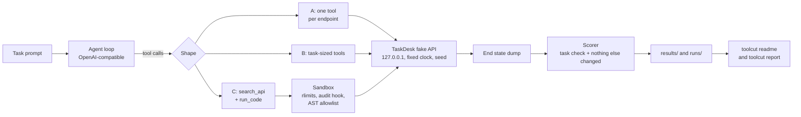

# toolcut

[](https://github.com/shreyas-tech7/toolshape/actions/workflows/ci.yml)

<!-- toolcut:status:start -->
**Status:** v0.1.0-rc1, a release candidate. The oracle solves 40 of 40 tasks in every shape and the wrong agents solve 0 of 240. Shape C's tool list is 1,136 bytes against 8,265 for shape A. No real model has run yet, so the model results are blocked (see Limits).
<!-- toolcut:status:end -->

toolcut holds one API fixed and changes only the shape of the MCP tools that an agent uses to reach it. Then it measures what each shape costs. Every number on this page is written by `toolcut readme` from a file in `results/` or `runs/`. No real model has run yet, so read the Limits part before you quote a number.

## The problem

When you put an API behind MCP, you have to pick a tool design. You can give the agent one tool per endpoint. You can write fewer tools that each do a whole job, like "find tasks for this person". Or you can give it two tools, one to search the API and one to run code against a typed client, which is the design that the Anthropic post on [code execution with MCP](https://www.anthropic.com/engineering/code-execution-with-mcp) describes.

Most comparisons change the API, the tasks and the model at the same time, so you cannot tell which change made the difference. toolcut keeps the API, the tasks, the scorer and the agent loop the same, and swaps only the tools.

<!-- toolcut:facts:start -->
TaskDesk has 25 endpoints. The benchmark has 40 tasks in 5 categories (bulk, lookup, multi, names, single). Shape A has 25 tools, shape B has 8 and shape C has 2.
<!-- toolcut:facts:end -->

- **Shape A:** one tool per endpoint, with the endpoint's own parameters.
- **Shape B:** task-sized tools that take names as well as ids, read every page and update many records at once.
- **Shape C:** `search_api` to find client methods and `run_code` to run a short Python script against the client in a sandbox.

A task passes only when the fake API's end state is right and nothing else changed.

## How it works



Each shape runs as a real MCP server over stdio (`python -m toolcut.mcp_server --shape A`). Three scripted agents need no model. The oracle runs a known plan for each task through the shape's own tools. Two wrong agents do nothing or solve the wrong task, which proves the scorer can tell right from wrong. The agent loop talks to any OpenAI-compatible endpoint, records every exchange to a fixture and can replay it offline.

## Results

<!-- toolcut:results:start -->
| Shape | Oracle passes [95% CI] | Wrong agents pass | Calls per task [95% CI] | Round-trip tokens per task [95% CI] | Seconds per task |
|---|---|---|---|---|---:|
| A: one tool per endpoint | 40/40 [91%, 100%] | 0/80 | 7.1 [3.1, 12.9] | 1,047 [572, 1,617] | 0.024 |
| B: task-sized tools | 40/40 [91%, 100%] | 0/80 | 6.2 [2.5, 11.7] | 764 [338, 1,283] | 0.022 |
| C: search_api + run_code | 40/40 [91%, 100%] | 0/80 | 2.0 [2.0, 2.0] | 1,603 [1,597, 1,608] | 0.084 |

Source: `results/oracle.json`, 2026-11-20, seed 42, transport mcp, no model (scripted oracle). Pass intervals are Wilson. Mean intervals are a bootstrap over the 40 tasks (2,000 resamples, seed 7). Seconds depend on the machine in `docs/ENVIRONMENT.md`.
<!-- toolcut:results:end -->

Tool definition sizes, read from each MCP server's tool list:

<!-- toolcut:sizes:start -->
| Shape | Tools | Definition bytes | Est. tokens |
|---|---:|---:|---:|
| A: one tool per endpoint | 25 | 8,265 | 2,067 |
| B: task-sized tools | 8 | 4,739 | 1,185 |
| C: search_api + run_code | 2 | 1,136 | 284 |

Source: `results/tool_sizes.json`, 2026-11-20, read over mcp. Tokens are bytes / 4, rounded up. No model.
<!-- toolcut:sizes:end -->

Results with a real model:

<!-- toolcut:model:start -->
No run with a real model yet. This machine has no provider key and cannot reach api.groq.com or openrouter.ai (see `BLOCKERS.md`). `docs/HUMAN_STEPS.md` gives the two commands that record one.
<!-- toolcut:model:end -->

The full report, with every task, is in [docs/REPORT.md](docs/REPORT.md). The results page is [docs/index.html](docs/index.html).

## Cost per task

A free model costs nothing per call, so the cost here is tokens. The scripted run below sends the oracle's exact calls through the real agent loop, one call per turn, so it is the least an agent can pay to make those calls. A real model will pay more.

<!-- toolcut:cost:start -->
| Shape | Passes [95% CI] | Model turns per task | Input tokens per task [95% CI] | Output tokens per task | Of which tool definitions |
|---|---|---:|---|---:|---:|
| A: one tool per endpoint | 40/40 [91%, 100%] | 8.1 | 54,467 [12,978, 116,000] | 311 | 18,314 |
| B: task-sized tools | 40/40 [91%, 100%] | 7.2 | 38,707 [6,301, 86,827] | 301 | 8,964 |
| C: search_api + run_code | 40/40 [91%, 100%] | 3.0 | 3,765 [3,749, 3,780] | 1,279 | 897 |

Source: `runs/scripted/state.json`, 2026-11-20, model `fake-oracle-replay` (local fake endpoint), transport inprocess. This is not a language model. A local fake endpoint replays the oracle's calls one per turn through the real agent loop, so it shows the least an agent pays to make those calls. Token source: provider (bytes / 4).
<!-- toolcut:cost:end -->

Differences against shape A, paired by task:

<!-- toolcut:paired:start -->
| Comparison | Calls per task, difference [95% CI] | Input tokens per task, difference [95% CI] |
|---|---|---|
| B minus A | -0.93 [-1.45, -0.47] | -15,760 [-29,063, -6,585] |
| C minus A | -5.12 [-10.93, -1.07] | -50,702 [-112,232, -9,224] |

Paired by task. The interval resamples the 40 task pairs. Calls come from the oracle run and tokens from the scripted agent run.
<!-- toolcut:paired:end -->

### When each shape wins

<!-- toolcut:wins:start -->
| Category | What it means | Tasks | Mean calls A / B / C | Mean input tokens A / B / C | Fewest tokens |
|---|---|---:|---|---|---|
| single | one change to one known record | 8 | 1.1 / 1.1 / 2.0 | 5,307 / 3,100 / 3,710 | B |
| names | the task names people or projects, not ids | 8 | 2.1 / 2.1 / 2.0 | 8,399 / 4,712 / 3,732 | C |
| multi | a few dependent steps | 8 | 3.6 / 3.4 / 2.0 | 13,114 / 7,035 / 3,781 | C |
| bulk | the same change to many records | 7 | 5.6 / 3.4 / 2.0 | 20,592 / 7,541 / 3,780 | C |
| lookup | a question answered by reading and counting | 9 | 21.2 / 19.0 / 2.0 | 202,218 / 152,966 / 3,818 | C |

Computed from the oracle run and the scripted agent run. A real model adds wrong turns and retries that these numbers leave out.
<!-- toolcut:wins:end -->

Shape A resends every endpoint's definition on every turn, and its results pile up in the conversation. That cost grows with the number of steps, so it is worst on lookups that read many pages. Shape B cuts the definitions and the steps for name lookups and bulk changes, but a lookup that must read every comment still takes many calls. Shape C pays a fixed cost: one search and one script, whatever the task. It writes more output tokens, because the script is output. That matches what the Anthropic post and the AIMultiple test reported, though here the tokens are a floor from a scripted run, not from a model. Whether a model can write those scripts correctly is the open question, and only a real run answers it.

## 10-minute run guide

You need Python 3.11 or newer and [uv](https://docs.astral.sh/uv/). Nothing here needs a key or the network after install.

```bash
git clone https://github.com/shreyas-tech7/toolshape.git
cd toolshape
./init.sh                                   # install, lint, run every test offline
.venv/bin/toolcut demo --task t07           # one task solved in each shape over MCP
.venv/bin/toolcut sizes                     # results/tool_sizes.json
.venv/bin/toolcut oracle --transport mcp    # results/oracle.json
.venv/bin/toolcut scripted --fresh          # runs/scripted, the agent loop against a local fake endpoint
.venv/bin/toolcut replay                    # replays runs/scripted from its fixtures, offline
.venv/bin/toolcut report                    # docs/REPORT.md
.venv/bin/toolcut readme --check            # fails if this page differs from the results files
```

To record a run with a real model, put a free key in an environment variable and point `toolcut record` at any OpenAI-compatible endpoint. The run is resumable. Stop it at any time and run the same command again.

```bash
export GROQ_API_KEY=...      # never commit it
.venv/bin/toolcut record --run-dir runs/model --base-url https://api.groq.com/openai/v1 \
  --model llama-3.1-8b-instant --key-env GROQ_API_KEY
.venv/bin/toolcut report && .venv/bin/toolcut readme
```

To try your own tool design, follow [docs/ADDING_A_SHAPE.md](docs/ADDING_A_SHAPE.md).

## Limits

- **No real model yet:** this machine had no provider key and could not reach any model host, so every token number comes from the scripted run. Those numbers are a floor. They leave out wrong turns, retries and the model's own reasoning. See [BLOCKERS.md](BLOCKERS.md).
- **One fake API:** TaskDesk is small and invented. Its data is synthetic and seeded. A real API has more endpoints, rate limits and messier errors, and the gaps between shapes would likely be larger.
- **One model, when there is one:** a single model's results say how that model handles these shapes. They do not rank the shapes for every model.
- **Tokens are estimated:** the scripted run counts tokens as bytes / 4. A real run uses the provider's usage field when it has one and marks each episode with where its count came from.
- **One call per turn:** the scripted run makes one tool call per model turn. Real models can make several calls in one turn, which would help shapes A and B.
- **The sandbox is not a security sandbox:** it guards this local benchmark only. It stops a script from opening sockets other than the fake API, reading or writing outside its temp folder, starting processes or running too long. A determined attacker with a CPython escape would get past it. Do not run code you do not trust with it. Details are in [docs/SECURITY_CHECKS.md](docs/SECURITY_CHECKS.md).
- **Tool output is data:** the agent loop sends tool results back to the model as tool messages and its system prompt says they are never instructions. That lowers the risk of a planted instruction in the data. It does not remove it.

## Glossary

- **MCP:** the Model Context Protocol, a standard way for an agent to list and call tools on a server.
- **Shape:** one design of MCP tools over the same API.
- **Tool definition:** a tool's name, description and JSON schema. The model reads all of them on every turn.
- **Oracle:** a scripted agent that runs a known correct plan. It shows each task is solvable in each shape.
- **Wrong agent:** a scripted agent that does nothing or solves the next task. It shows the scorer catches failures.
- **Round trip:** the bytes of a tool call's arguments plus its result.
- **Scripted run:** the agent loop run against a local fake endpoint that replays the oracle's calls. It is not a model.
- **Record mode and replay:** record mode saves every model exchange to a fixture. Replay reads the fixture back and fails if the loop sends a different request.
- **Wilson interval:** a 95% interval for a pass rate that stays sensible at 0% and 100%.
- **Bootstrap interval:** a 95% interval for a mean, found by resampling the tasks many times.
- **Paired difference:** the difference between two shapes on the same task, averaged over tasks.

## Related work

- [MCPToolBench++](https://arxiv.org/abs/2508.07575) tests how well models use many real MCP servers. It varies the servers, while toolcut holds the server's API fixed.
- [LiveMCPBench](https://arxiv.org/html/2508.01780v2) tests agents across a large set of live MCP tools and tasks.
- [TheMCPCompany](https://arxiv.org/abs/2510.19286) tests agents on enterprise tasks over many MCP tools.
- [Code execution with MCP](https://www.anthropic.com/engineering/code-execution-with-mcp) by Anthropic argues for letting the agent write code against tools instead of calling each tool directly.
- [AIMultiple's test of code execution with MCP](https://research.aimultiple.com/code-execution-with-mcp) reported 78.5% fewer input tokens (165K against 771K) and 2.2 times more output tokens with code execution, on GPT-4.1 only. toolcut asks the same question with the API held fixed.

## How this was built

AI agents wrote most of this code under Shreyas's direction, from the build prompt in [docs/build/BUILD_PROMPT.md](docs/build/BUILD_PROMPT.md). Choices made during the build are in [DECISIONS.md](DECISIONS.md) and open problems are in [BLOCKERS.md](BLOCKERS.md).

Human checks, not done yet:

- A person has read the code and the tests.
- A person has run the 10-minute guide on a clean machine.
- A person has recorded a run with a real model.
